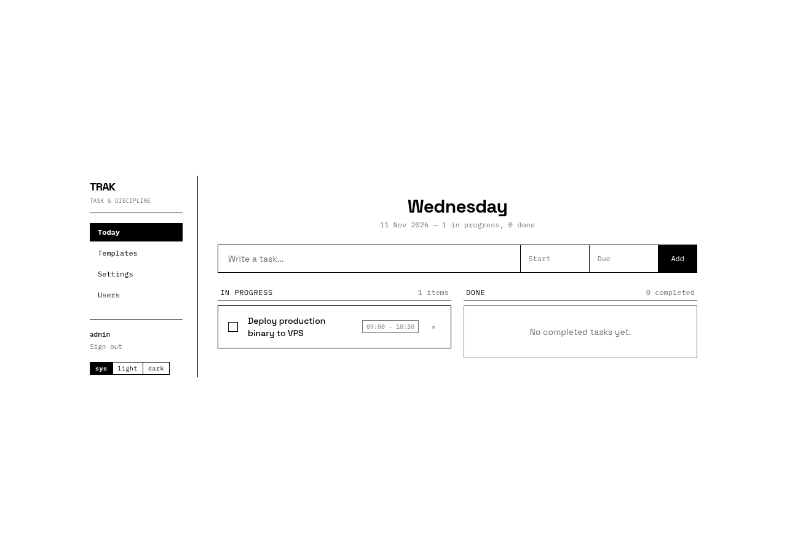

# trak

Self-hosted daily task scheduler and discipline engine built with Rust, Leptos, and SQLite.



## Overview

Trak provides a focused daily task planner with recurring weekly templates, ntfy push notifications, multi-user role management, and an uncompromising monochrome brutalist interface.

## Tech Stack

- Backend: Axum 0.7, SQLx (SQLite WAL mode), Argon2id password hashing, HMAC-SHA256 session tokens
- Frontend: Leptos 0.7 (SSR + Hydration), Tailwind CSS
- Tooling: Nix flake, cargo-leptos, Playwright E2E

## Development

Prerequisites: Nix with flakes enabled (or Rust 1.80+ and cargo-leptos).

```bash
# Enter development shell
direnv allow # or: nix develop

# Start development server with live reload
cargo leptos watch
```

Server listens on `http://127.0.0.1:3000`.

## Production Deployment

### Build Release Artifacts

```bash
cargo leptos build --release
```

Release binaries and compiled assets are emitted to:
- Server binary: `target/release/trak`
- Client assets: `target/site/`

### Configuration

Copy `.env.example` to `/etc/trak/trak.env` and configure:

```bash
LEPTOS_SITE_ADDR=127.0.0.1:3000
DATABASE_URL=sqlite:///var/lib/trak/trak.db
JWT_SECRET=your_random_secret_at_least_32_characters
```

### Systemd & Reverse Proxy

Deployment templates are provided in `deploy/`:
- `deploy/trak.service`: Hardened systemd service unit
- `deploy/Caddyfile`: Reverse proxy with automated TLS and security headers
- `deploy/trak-backup.sh`: Daily non-blocking SQLite hot backup

## License

MIT
